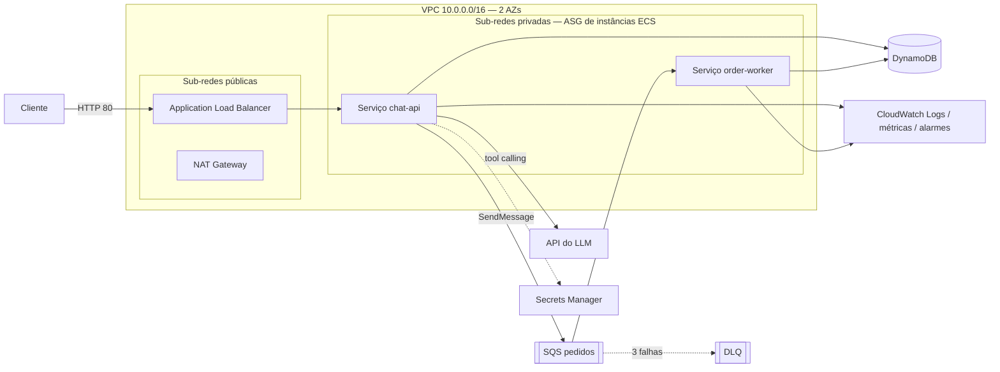

# Proposta de arquitetura — Comércio Conversacional na AWS

Alvo: conceito **B em todas as dimensões**, com alguns itens baratos de nível A onde o custo de implementação é baixo (marcados com **[A]**).

Entrega em duas rodadas: primeiro a versão C, que usa esta mesma topologia no formato mais simples, e depois o upgrade para B. O que entra em cada rodada está em [planejamento.md](planejamento.md#estratégia-c-primeiro-depois-b).

## 1. Domínio e escopo do MVP

**Loja de cafés especiais** ("Grão"): o cliente conversa com um vendedor de IA que recomenda cafés, consulta preço e estoque, aplica desconto por quantidade e registra o pedido.

Motivos da escolha: catálogo pequeno e fácil de popular, estoque numérico (permite demonstrar concorrência e consistência), e uma regra de negociação simples (desconto progressivo) que não exige lógica complexa.

Jornada mínima:

1. Cliente: "quero um café frutado, até R$ 60" → IA chama `buscar_produtos`.
2. Cliente: "tem 3 pacotes do Etiópia?" → IA chama `consultar_estoque`.
3. Cliente: "fecha 3" → IA chama `criar_pedido` → pedido gravado como `PENDENTE` e enviado para a fila.
4. O worker reserva o estoque e muda o pedido para `CONFIRMADO` ou `REJEITADO`.
5. Cliente: "meu pedido foi confirmado?" → IA chama `consultar_pedido`.

## 2. Stack

| Camada | Escolha | Por quê |
|---|---|---|
| Linguagem | Python 3.12 + FastAPI | Simples, boto3 nativo, um único idioma para os dois serviços |
| IA | API de LLM externa com *tool calling*, modelo definido por variável `MODEL_ID` | Independe de região (não há risco de o modelo não existir em sa-east-1) e gera um segredo real para o Secrets Manager |
| Persistência | DynamoDB (on-demand) | Sem instância para gerenciar, barato, escrita condicional resolve estoque e idempotência |
| Mensageria | SQS standard + DLQ | Requisito direto da rubrica, integração simples |
| Front | Página HTML estática servida pelo próprio `chat-api` | A interface não é avaliada |

Alternativa para a IA: Amazon Bedrock (dispensa chave e usa IAM), mas a disponibilidade de modelos difere entre Ohio e São Paulo — vira dependência regional a ser tratada.

## 3. Topologia

### Serviços ECS

| | `chat-api` | `order-worker` |
|---|---|---|
| Responsabilidade | Front, endpoint `/chat`, orquestra o LLM e as tools, grava conversa e pedido `PENDENTE` | Consome a fila, reserva estoque, confirma ou rejeita o pedido |
| Entrada | ALB (síncrono) | SQS (assíncrono) |
| Perfil de carga | I/O intenso, latência dominada pelo LLM, muitas conexões abertas | Rajadas curtas conforme a fila |
| Métrica de escala | `ALBRequestCountPerTarget` (target tracking) | Mensagens visíveis na fila (target tracking, alvo ≈ 10 por task) |
| Tasks min / max | 2 / 6 | 1 / 4 |
| Health check | `GET /health` no target group | `healthCheck` do container (heartbeat do loop de consumo) |

Justificativa da decomposição:

- **Isolamento de falhas**: se o LLM ficar lento ou fora do ar, só o `chat-api` degrada; pedidos já enfileirados continuam sendo processados. Se o worker cair, a conversa continua e os pedidos esperam na fila.
- **Escala independente**: o chat escala por requisições, o worker por profundidade de fila.
- **Consistência**: toda alteração de estoque passa por um único componente.

O `/health` **não** chama o LLM nem o DynamoDB — do contrário, uma indisponibilidade do LLM derrubaria todas as tasks de uma vez.

### Modelo de dados (DynamoDB)

| Tabela | Chave | Conteúdo |
|---|---|---|
| `produtos` | `produto_id` | nome, descrição, notas sensoriais, preço, `estoque` |
| `conversas` | `conversa_id` + `timestamp` | mensagens do cliente e da IA, tools chamadas |
| `pedidos` | `pedido_id` | conversa, itens, total, `status`, timestamps |

### Tratamento de falhas e duplicidade

- `chat-api` gera o `pedido_id` (UUID) e grava com `attribute_not_exists(pedido_id)`.
- O worker só processa se `status = PENDENTE` (escrita condicional) → mensagem duplicada vira no-op **[A]**.
- Baixa de estoque com condição `estoque >= quantidade` → nunca fica negativo, mesmo com workers concorrentes **[A]**.
- Fila: long polling de 20 s, visibility timeout de 60 s, `maxReceiveCount = 3`, depois DLQ.
- LLM: timeout de 20 s e uma retentativa; em falha, resposta amigável e nenhum pedido criado.

## 4. Rede

| Recurso | Configuração |
|---|---|
| VPC | `10.0.0.0/16`, 2 AZs obtidas dinamicamente |
| Sub-redes públicas | `10.0.0.0/24`, `10.0.1.0/24` — ALB e NAT |
| Sub-redes privadas | `10.0.10.0/24`, `10.0.11.0/24` — instâncias ECS |
| Saída para internet | **1 NAT Gateway** (ECR, CloudWatch, SQS, API do LLM) |
| VPC endpoints | Gateway para S3 e DynamoDB (gratuitos) |

Um único NAT é uma decisão consciente de custo: a perda da AZ do NAT interromperia a saída das instâncias. Vale citar na apresentação como trade-off; um NAT por AZ seria o passo para nível A.

Security groups:

| SG | Entrada | Saída |
|---|---|---|
| `alb-sg` | TCP 80 de `0.0.0.0/0` | Portas 32768–65535 para `ecs-sg` |
| `ecs-sg` | Portas 32768–65535 **somente de `alb-sg`** | TCP 443 para `0.0.0.0/0` |

Sem SSH: acesso às instâncias via SSM Session Manager.

## 5. ECS sobre EC2 e capacidade

| Item | Valor |
|---|---|
| Instância | `t3.small` (2 vCPU, 2 GiB → ~2048 CPU units e ~1900 MiB registráveis) |
| AMI | ECS-optimized Amazon Linux 2023, lida do parâmetro público SSM `/aws/service/ecs/optimized-ami/amazon-linux-2023/recommended/image_id` |
| ASG | min 2 / desejado 2 / máx 4, nas duas sub-redes privadas |
| Capacity Provider | managed scaling ligado, `targetCapacity = 100`, managed termination protection e managed draining ligados |
| Modo de rede das tasks | `bridge` com porta dinâmica (evita o limite de ENIs do `awsvpc` em instâncias pequenas) |
| Posicionamento | `spread` por AZ, depois `binpack` por memória |
| Deploy | `minimumHealthyPercent = 100`, `maximumPercent = 200`, circuit breaker com rollback |

Reservas por task:

| Serviço | CPU | Memória (reserva / limite) |
|---|---|---|
| `chat-api` | 256 | 384 / 512 MiB |
| `order-worker` | 128 | 192 / 256 MiB |

Conta de capacidade: uma `t3.small` comporta cerca de 3 tasks `chat-api` + 2 `order-worker` (limitado por memória). Com 2 instâncias, o estado base (2 + 1 tasks) usa ~25% da memória reservável; o máximo (6 + 4 tasks) pede ~3100 MiB, forçando o Capacity Provider a subir para 3–4 instâncias. É exatamente esse salto que demonstra o segundo nível de elasticidade.

`spread` por AZ garante que as 2 tasks do chat fiquem em instâncias diferentes (disponibilidade); `binpack` concentra o restante e libera instâncias inteiras para o scale-in.

## 6. Segurança

| Role | Permissões |
|---|---|
| Instância EC2 | `AmazonEC2ContainerServiceforEC2Role` + `AmazonSSMManagedInstanceCore` |
| Execução das tasks | Pull no ECR, escrita em logs, leitura **apenas** do segredo da chave do LLM |
| Task `chat-api` | Leitura em `produtos`; leitura/escrita em `conversas` e `pedidos`; `sqs:SendMessage` na fila de pedidos |
| Task `order-worker` | `sqs:ReceiveMessage/DeleteMessage` na fila; `dynamodb:GetItem` em `pedidos`; `dynamodb:UpdateItem` em `produtos` e `pedidos` (cobre o `TransactWriteItems`) |

Chave do LLM no Secrets Manager, injetada pelo ECS no campo `secrets` da task definition — nunca em código, imagem ou `.tfvars`.

## 7. Observabilidade

- **Logs**: um log group por serviço (driver `awslogs`), em JSON, com `conversa_id`, `pedido_id` e `request_id` para correlacionar chat → fila → worker.
- **Container Insights** ligado no cluster.
- **Alarmes** (notificação por SNS/e-mail):

| Área | Alarme |
|---|---|
| Tasks | `RunningTaskCount` abaixo do desejado, por serviço |
| Cluster | Reserva de memória e de CPU > 85% |
| ASG | `GroupInServiceInstances` < mínimo |
| ALB | `HTTPCode_Target_5XX_Count` alto; `UnHealthyHostCount` > 0 |
| Fila | Idade da mensagem mais antiga > 5 min; DLQ com mensagens > 0 |
| Aplicação | Metric filter sobre `"level":"ERROR"` nos logs |

## 8. Imagens e portabilidade regional

- Um repositório ECR por serviço **em cada região**.
- Um script `build-and-push` constrói a imagem uma vez e publica na região indicada por parâmetro. São Paulo nunca referencia o ECR de Ohio.
- Nada fixo no código: região, AZs, AMI, ARNs e URLs de fila chegam por variáveis de ambiente ou data sources.

## 9. O que fica de fora (caminho para A)

HTTPS com ACM e domínio próprio, NAT por AZ, métricas de negócio customizadas (pedidos/min, taxa de rejeição), dashboard, teste de carga com análise quantitativa, reprocessamento automático da DLQ.
