# Evidências das demonstrações

Registro do ensaio do roteiro da [Fase 3](planejamento.md#fase-3--roteiro-de-demonstração-usado-nas-duas-etapas) nas duas etapas, em 2026-11-18 (horários de Brasília). Os gráficos foram exportados do CloudWatch (`get-metric-widget-image`, período de 1 minuto) e ficam em [`evidencias/`](evidencias/).

Como provocar cada cenário: seção **Demonstrações** do [ohio-manual.md](ohio-manual.md) (os mesmos comandos servem para São Paulo, trocando a região).

## Etapa 1 — Ohio (us-east-2, criada à mão)

### Escala de tasks e de instâncias (17:18 – 17:46)

Carga: `scripts/enfileirar-pedidos.py 6000` às 17:18 e duas instâncias de `scripts/carga.py` (60 + 150 conexões em `GET /produtos`, 10 min) a partir de ~17:19.

| Momento | O que aconteceu |
|---|---|
| 17:18 | 6000 pedidos na fila. Um único worker processou ~1800 por minuto e esvaziou a fila em ~4 min. |
| 17:24 | Worker escalou de 1 → 4 tasks (target tracking em mensagens por task). Chegou depois da fila vazia: as métricas do SQS chegam ao CloudWatch com 1 a 5 min de atraso. |
| 17:24 – 17:30 | CPU do chat acima de 60%: chat escalou 2 → 6 → 7 → 8 tasks. |
| 17:25 | A 7ª task do chat ficou em `PROVISIONING` (memória reservada das 2 EC2 esgotada). |
| 17:26 | Capacity Provider subiu o ASG de 2 → 3 instâncias; a task pendente foi colocada na EC2 nova. |
| 17:39 – 17:43 | Sem carga, scale-in do worker 4 → 3 → 2. |
| 17:46 | Ambiente pausado (tasks e ASG a zero) antes do fim do scale-in do chat. |

Carga HTTP: 41 277 requisições, 1 erro.

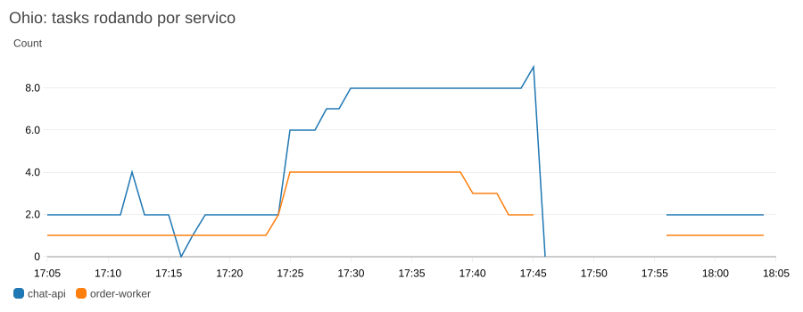
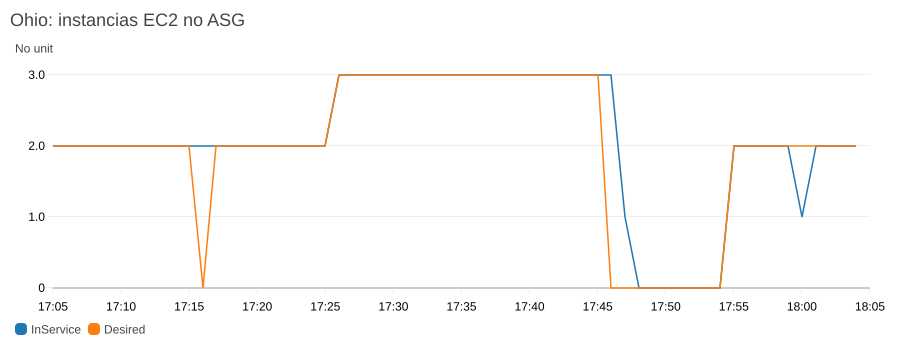
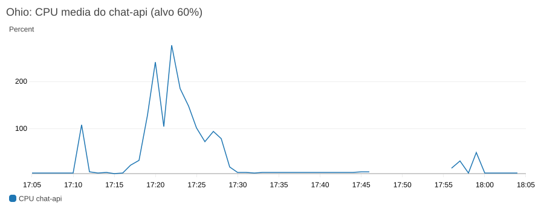
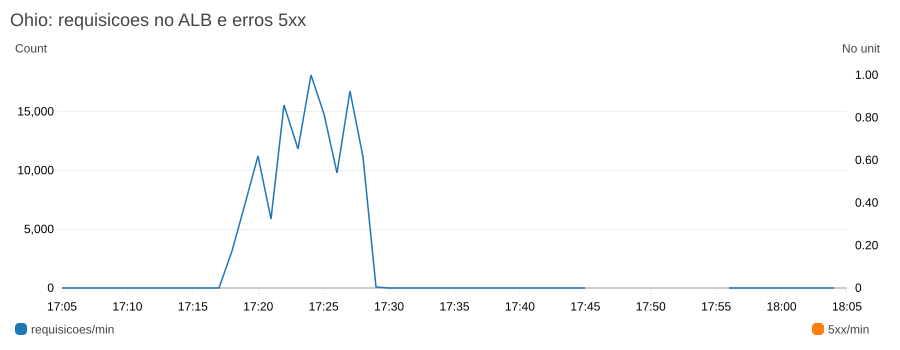
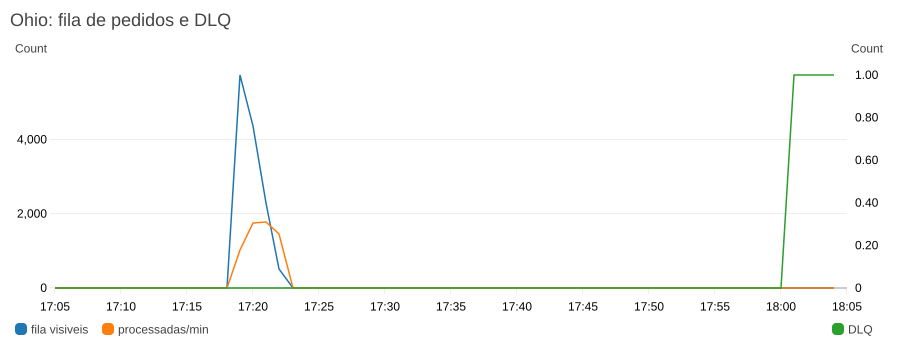

### Task defeituosa (17:57)

- `aws ecs stop-task` em uma das 2 tasks do chat às 17:57:28.
- Durante os 60 s seguintes, `GET /health` pelo ALB a cada segundo: **60 ok, 0 erros** (a outra task atendeu).
- O serviço iniciou uma task nova e registrou-a no target group; `runningCount` voltou a 2.

### Instância perdida (17:59)

- `aws ec2 terminate-instances` em uma das 2 EC2 às 17:59:25.
- 17:59:49: chat com 1 task rodando e 1 pendente (a task da instância perdida).
- 18:01:02: ASG repôs a EC2 e o chat voltou a 2/2 — **recuperação em ~1,5 min**.
- Dados intactos: as tabelas ficam no DynamoDB, fora das instâncias.
- O alarme `cafe-asg-instancias-abaixo` não chegou a disparar: a reposição foi mais rápida que os 2 períodos de avaliação.

### DLQ (17:57 – 18:04)

- Mensagem malformada (`isto nao e um pedido valido {`) publicada na fila às 17:57:30.
- O worker falhou ao processar (alarme `cafe-erros-no-log` em ALARM às 17:59).
- Após 3 recebimentos (`maxReceiveCount = 3`, visibilidade de 60 s) a mensagem foi para a DLQ: **DLQ = 1 às 18:01**.
- Alarme `cafe-dlq-com-mensagens` em ALARM às **18:04**.

## Etapa 2 — São Paulo (sa-east-1, criada com Terraform)

Ambiente criado por `terraform apply` ([terraform.md](terraform.md)) às 18:17. Smoke test pelo ALB às 18:23: pedido `CONFIRMADO` e pedido `REJEITADO` por estoque, ambos processados pelo worker via fila.

### Task defeituosa (18:26)

- `aws ecs stop-task` em uma das 2 tasks do chat às 18:26:55.
- `GET /health` pelo ALB a cada segundo por 60 s: **60 ok, 0 erros**; `runningCount` de volta a 2 às 18:28.

### Instância perdida (18:28)

- `aws ec2 terminate-instances` às 18:28:12; às 18:28:22 o chat estava com 1 task rodando.
- 18:29:15: ASG repôs a EC2 e o chat voltou a 2/2 — **recuperação em ~1 min**.
- Dados intactos: o pedido do smoke test continuou consultável em `GET /pedidos/{id}` depois da perda.

### DLQ (18:26 – 18:33)

- Mensagem malformada publicada às 18:26:56; `cafe-erros-no-log` em ALARM às 18:27.
- Mensagem na DLQ após os 3 recebimentos; alarme `cafe-dlq-com-mensagens` em ALARM às **18:33**.

### Escala de tasks e de instâncias (18:29 – 19:15)

Carga: `scripts/enfileirar-pedidos.py 6000` e duas instâncias de `scripts/carga.py` (60 + 150 conexões em `GET /produtos`, 10 min) a partir de 18:29. Resultado da carga HTTP: **103 969 requisições, 38 erros (0,04%)**.

| Momento | O que aconteceu |
|---|---|
| 18:30 | 6000 pedidos na fila; o worker processou ~1300 por minuto e esvaziou a fila em ~5 min. |
| 18:31 – 18:33 | CPU do chat entre 110% e 337% (alvo 60%). |
| 18:34 | Chat escalou 2 → 7 tasks (5 em `PENDING` baixando a imagem). |
| 18:36 | 7 tasks do chat rodando; worker escalou 1 → 4 (de novo depois da fila vazia, pelo atraso das métricas do SQS). |
| 18:38 | Chat 7 → 8; a 8ª task ficou pendente por falta de memória reservável nas 2 EC2. |
| 18:39 | Fim da carga HTTP. |
| 18:40 – 18:41 | Capacity Provider subiu o ASG 2 → 3 → 4 instâncias (o managed scaling dimensiona pelas tasks pendentes e deu um passo a mais que em Ohio); a 8ª task foi colocada. |
| 18:53 – 18:58 | Scale-in do worker 4 → 3 → 2 → 1. |
| 18:57 – 18:59 | Scale-in do chat começou (8 → 7 → 6); ASG 4 → 3: a instância vazia foi drenada (managed draining) e terminada. |
| 18:59 – 19:12 | Chat 6 → 5 → 4 → 3 → 2 tasks (uma a cada ~3 min, cooldown de scale-in). |
| 19:14 – 19:15 | ASG 3 → 2: a 3ª instância, já sem tasks, foi drenada e terminada. **Estado base restaurado** (chat 2, worker 1, 2 EC2), ~36 min após o fim da carga. |

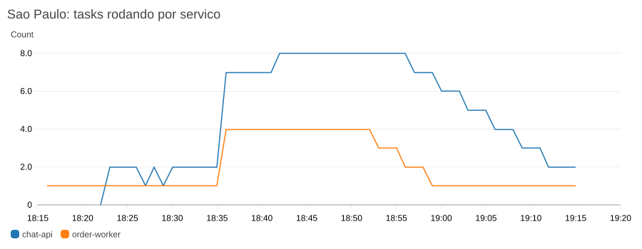
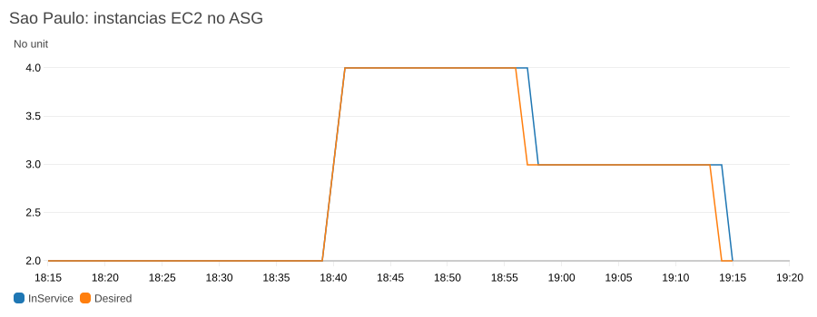
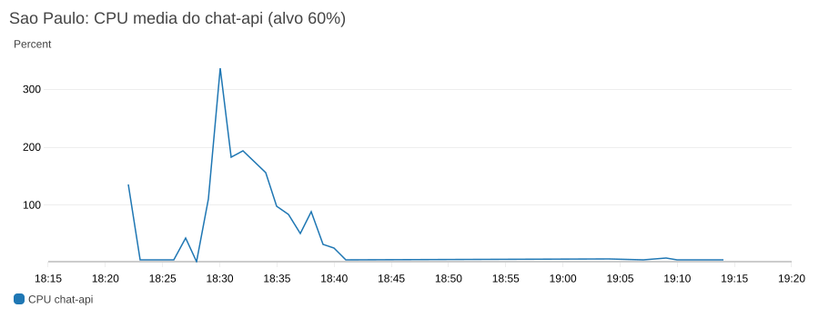
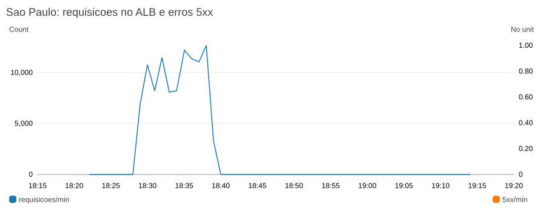
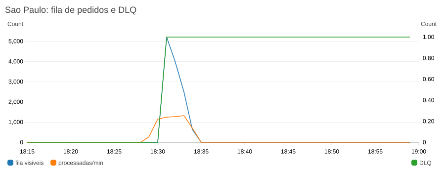

## Versão B — São Paulo recriado do zero (2026-11-20)

### Destroy e apply único

- `terraform destroy` completo (43 recursos) e `terraform apply` a partir da conta vazia às 15:04–15:10. O apply fez sozinho o build e o push das duas imagens, a carga dos 10 cafés no DynamoDB e a gravação do segredo; o único passo fora do Terraform foi colar o valor da chave do LLM no Secrets Manager, que de propósito não fica no código nem no state.
- Dois problemas achados e corrigidos no caminho (commits no histórico):
  - **Destroy preso em DRAINING**: o Terraform apagava a rota pública antes dos serviços; os agentes ECS perdiam a conexão e as tasks nunca terminavam de parar. As instâncias agora dependem também da rota pública e do IGW (`infra/modules/network/outputs.tf`).
  - **Build pelo provider docker** falhava no Docker Desktop do Windows; o build passou para o `docker` CLI chamado pelo próprio apply, e o push continua pelo provider.

### Funcionalidades novas, com o LLM real

- Conversa completa pelo ALB: recomendação (`buscar_produtos`), estoque (`consultar_estoque`), pedido (`criar_pedido`) e "e o meu pedido?" (`consultar_pedido`), que respondeu **CONFIRMADO** lendo a tabela de pedidos.
- Logs JSON: o mesmo `pedido_id` e `conversa_id` aparecem no `/ecs/cafe/chat-api` (linha `tool chamada` com o nome da ferramenta) e no `/ecs/cafe/order-worker` (`pedido confirmado; estoque baixado`).

### Escala por requisições e worker mais rápido (15:19 – 15:45)

| Momento | O que aconteceu |
|---|---|
| 15:19 – 15:27 | Carga em `GET /produtos` (60 conexões) e 6000 pedidos na fila (cheia às 15:22). |
| 15:26 | Worker 1 → 4 tasks (alvo 20 mensagens/task), ~4 min depois de a fila encher; na versão C levou ~6 min. A fila esvaziou no mesmo minuto: o atraso das métricas do SQS (1 a 5 min) continua sendo o limite. |
| 15:27 | Chat 2 → 3 pela CPU (`/produtos` pesa na CPU, então a política de CPU disparou primeiro). |
| 15:29 – 15:44 | Carga leve em `GET /health` (100 conexões, ~70 req/s): CPU do chat entre 10% e 37%. Com o alvo inicial de 1500 req/task/min nada aconteceu (~1 400 por task); o alvo foi recalibrado para 600. |
| 15:38 | **`cafe-chat-api-req600` subiu o chat 3 → 6 tasks com a CPU abaixo de 40%**: o caso que a política de CPU não pega (conversa real esperando o LLM, task ociosa). |
| 15:42 | Sem fila, scale-in do worker 4 → 3 (cooldown de 120 s). |

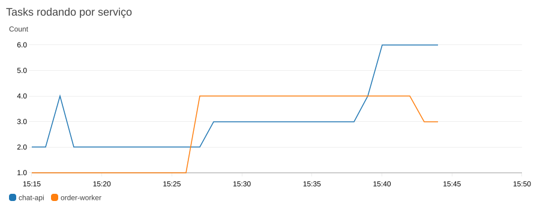
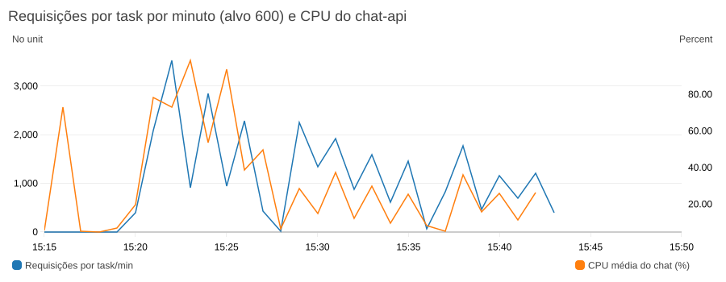
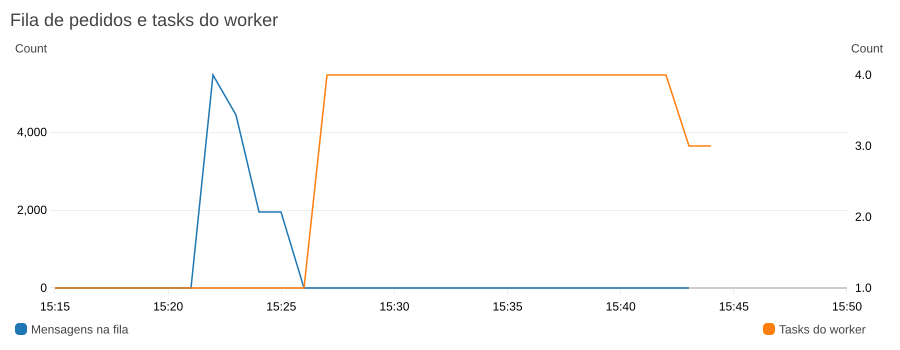
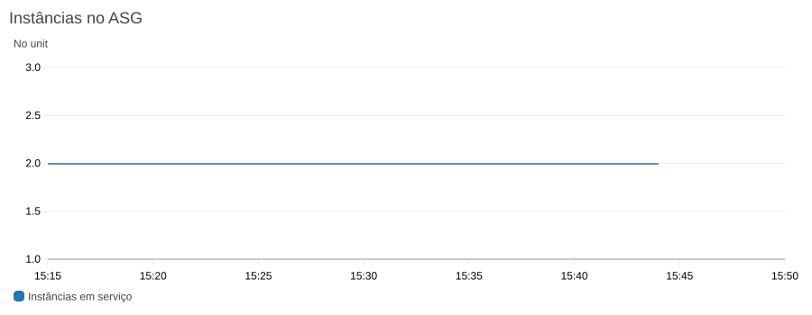

Ohio recebeu as mesmas mudanças à mão (políticas, limiares, filtro de erros e imagens novas; ver [ohio-manual.md](ohio-manual.md#upgrade-para-b-limiares-calibrados-e-imagens-novas)) e o chat respondeu com a tool `consultar_estoque` e logs JSON.

## Resumo

| Requisito demonstrado | Ohio (manual) | São Paulo (Terraform) |
|---|---|---|
| Escala de tasks por CPU (chat) | 2 → 8 | 2 → 8 |
| Escala de tasks pela fila (worker) | 1 → 4 | 1 → 4 |
| Escala de EC2 pelo Capacity Provider | 2 → 3 | 2 → 4 |
| Scale-in com drenagem | parcial (worker 4 → 2; ambiente pausado antes do fim) | completo: chat 8 → 2, worker 4 → 1, ASG 4 → 2 com managed draining (19:15) |
| Task defeituosa, ALB sem erro | 60/60 ok | 60/60 ok |
| Instância perdida, recuperação | ~1,5 min | ~1 min |
| Mensagem inválida na DLQ + alarme | sim (18:04) | sim (18:33) |
| Escala por requisições no ALB (B, alvo 600) | configurada | chat 3 → 6 com CPU < 40% (20/11 15:38) |
| Worker com alvo 20 e scale-out em 30 s (B) | configurado | 1 → 4 em ~4 min (C: ~6 min) |
| Destroy completo + apply único do zero (B) | — | sim (20/11, 43 destruídos; recriado com build, catálogo e segredo) |
